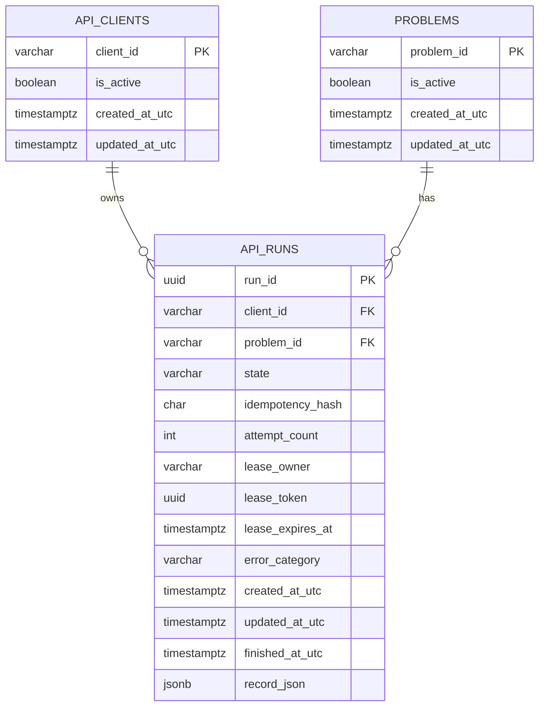

# Abacus database architecture

## Goals

- Keep identity, relationships, run state, and idempotency relational and enforceable by the database.
- Keep the existing versioned run evidence as one JSON document because its nested fields evolve with the run-record schema and are fetched as a whole.
- Use SQLite for local development and tests, and PostgreSQL for the Compose deployment.
- Preserve rows from the original SQLite `api_runs` table when Alembic applies the first migration.
- Make a retry safe under concurrent requests and prevent a run from reaching an impossible lifecycle shape.

## Entity model

`problems` stores only the stable identity and whether a problem is currently available. The checked-in problem files remain the source of claim, target, contract, and oracle content. This prevents those fields being copied into each run and becoming inconsistent when a problem definition changes. Existing historical problem IDs remain in this table so their run rows keep valid foreign keys; startup marks only the current allowlist active.

`api_clients` stores configured client identities, not credentials. `ABACUS_CLIENT_API_KEYS` supplies each client's unique secret through deployment environment configuration; only its client ID enters database rows. The legacy `ABACUS_API_KEY` maps to the `default` client. `api_runs` belongs to one client and one problem. Its idempotency uniqueness is `(client_id, idempotency_hash)`, and run reads are scoped to the authenticated client. Raw API keys and raw idempotency keys are never stored; only the idempotency SHA-256 digest is persisted.

`api_runs` owns the mutable lifecycle and one result snapshot. `record_json` is JSONB on PostgreSQL and JSON on SQLite. It contains evidence tied to the run-record schema version. The API derives `run_status` and `outcome` from this snapshot instead of storing duplicate copies in columns, avoiding disagreement between a summary and its evidence. Query-critical fields such as client, problem, state, timestamps, and idempotency are normal columns with database constraints.

## Integrity rules

The database enforces:

- One primary key per problem and run.
- A foreign key from each run to an existing problem, with `ON DELETE RESTRICT` so a referenced problem cannot disappear.
- One unique idempotency digest per client. The insert uses `ON CONFLICT DO NOTHING RETURNING` and reads the winning row, including when simultaneous requests use the same key.
- A 64-character idempotency digest.
- Only recognized lifecycle states.
- A lifecycle shape check: queued rows have no lease; running rows require an owner, token, expiry, and at least one attempt; terminal rows have no lease; finished rows have evidence; failed/interrupted rows have an error category and finish time.
- Updated and finished timestamps cannot precede the creation timestamp.
- Conditional state updates so only queued runs start, only running runs finish, and only nonterminal runs fail.
- UTC-aware timestamps at the application boundary.

Before persistence, the API checks the run ID, status, outcome and strict JSON serialization (`NaN` and infinity are rejected). The state and record are written in the same transaction. A failed constraint or write rolls back the whole transition. SQLite foreign keys are enabled for every connection; PostgreSQL enforces them natively.

## Transactions and concurrency

Reserving a run is one insert protected by the scoped idempotency constraint. A duplicate request retrieves the existing row rather than creating another evaluation. A worker claims the oldest queued run in a short transaction. PostgreSQL workers use `FOR UPDATE SKIP LOCKED`, so each concurrent worker gets a distinct row. The worker stores a random lease token and expiry, renews the lease while evaluating, and must present the same token to finish or fail the run. A stale worker cannot commit after its lease is reclaimed.

Expired leases are requeued up to three attempts. If all attempts expire, the run is marked interrupted for operator review. PostgreSQL is the deployment database; SQLite remains suitable for local development and single-worker tests. Compose runs the API in queue mode and one worker by default; use `docker compose up -d --scale abacus-worker=N` to run more workers.

## Migrations and recovery

Alembic revision `0001_relational_run_store` creates the constrained schema and preserves validated legacy rows. Revision `0002_scoped_api_clients` adds the `default` client and maps historical runs to it before changing the idempotency constraint. Revision `0003_worker_leases` adds attempt/lease fields and moves any pre-lease `running` rows to `interrupted`, since their in-flight process cannot be safely resumed. Stop the old API and workers before applying a release migration.

The API applies pending migrations during startup before accepting requests. Schema changes after this baseline must be added as new reviewed Alembic revisions; do not edit an already-applied revision. Compose creates a validated custom-format PostgreSQL dump immediately on startup, repeats daily, and retains 14 days in the separate `postgres-backups` volume by default. Copy backups off the Docker host for disaster recovery. Before a schema release, take a manual dump; restore by stopping API/workers, recreating the database, and running `pg_restore`. The exact PowerShell commands are in the README's PostgreSQL backup and restore section.

`practice/test_postgres_integration.py` exercises migrations, PostgreSQL-native UUID/JSONB types, foreign-key/check constraints, concurrent idempotency, and a real API evaluation against a live PostgreSQL server. GitHub Actions starts PostgreSQL 17 as a service and runs this suite separately from the SQLite regression matrix. For a local server, set `ABACUS_TEST_POSTGRES_URL` to a disposable database URL and run `python -m unittest practice.test_postgres_integration -v`.

## Future client administration

Client identities are now separate and idempotency is tenant-scoped, but client provisioning and rotation are still deployment-operator tasks: edit the secret mapping, restart the API, and retain a stable client ID to preserve run visibility. A future admin workflow can add managed API-key rotation, per-client quotas, and role-based access without storing raw secrets.
