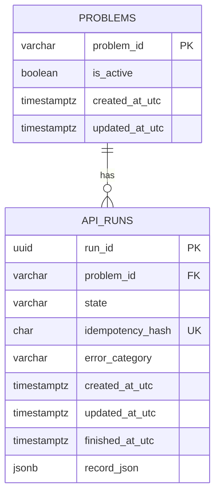

# Abacus database architecture

## Goals

- Keep identity, relationships, run state, and idempotency relational and enforceable by the database.
- Keep the existing versioned run evidence as one JSON document because its nested fields evolve with the run-record schema and are fetched as a whole.
- Use SQLite for local development and tests, and PostgreSQL for the Compose deployment.
- Preserve rows from the original SQLite `api_runs` table when Alembic applies the first migration.
- Make a retry safe under concurrent requests and prevent a run from reaching an impossible lifecycle shape.

## Entity model

`problems` stores only the stable identity and whether a problem is currently available. The checked-in problem files remain the source of claim, target, contract, and oracle content. This prevents those fields being copied into each run and becoming inconsistent when a problem definition changes. Existing historical problem IDs remain in this table so their run rows keep valid foreign keys; startup marks only the current allowlist active.

`api_runs` owns the mutable lifecycle and one result snapshot. `record_json` is JSONB on PostgreSQL and JSON on SQLite. It contains evidence tied to the run-record schema version. The API derives `run_status` and `outcome` from this snapshot instead of storing duplicate copies in columns, avoiding disagreement between a summary and its evidence. Query-critical fields such as problem, state, timestamps, and idempotency are normal columns with database constraints. API keys and raw idempotency keys are never stored; only a SHA-256 digest is persisted.

## Integrity rules

The database enforces:

- One primary key per problem and run.
- A foreign key from each run to an existing problem, with `ON DELETE RESTRICT` so a referenced problem cannot disappear.
- One unique idempotency digest per run. The insert uses `ON CONFLICT DO NOTHING` and reads the row that won, including when simultaneous requests use the same key.
- A 64-character idempotency digest.
- Only recognized lifecycle states.
- A lifecycle shape check: queued/running rows have no result or finish time; finished rows have a result and finish time; failed/interrupted rows have an error category and finish time but no success result.
- Updated and finished timestamps cannot precede the creation timestamp.
- Conditional state updates so only queued runs start, only running runs finish, and only nonterminal runs fail.
- UTC-aware timestamps at the application boundary.

Before persistence, the API checks the run ID, status, outcome and strict JSON serialization (`NaN` and infinity are rejected). The state and record are written in the same transaction. A failed constraint or write rolls back the whole transition. SQLite foreign keys are enabled for every connection; PostgreSQL enforces them natively.

## Transactions and concurrency

Reserving a run is one insert protected by the unique idempotency constraint. A duplicate request retrieves the existing row rather than creating another evaluation. Each lifecycle transition is a compare-and-set `UPDATE ... WHERE state = expected_state` and must update exactly one row. Final outcome metadata and the JSON evidence are committed together.

Run execution currently occurs synchronously in the API process and is limited to one active run per process. PostgreSQL makes persistent relational storage suitable for a hosted deployment, but a background queue and worker lease protocol are still needed before horizontally scaling run execution. SQLite remains suitable for local development and the test suite.

## Migrations and recovery

Alembic revision `0001_relational_run_store` creates the constrained schema. On an existing pre-migration database, it first validates every legacy row and confirms that summary columns agree with the decoded JSON evidence. Only then does it rename the old `api_runs` table, create the new tables, copy run IDs, timestamps, hashes, and evidence in batches, insert the referenced problem IDs, and remove the legacy table. If validation fails, migration stops before renaming the original table; it never silently drops or rewrites a run.

The API applies pending migrations during startup before accepting requests. This deployment currently runs one API process in Compose. Schema changes after this baseline must be added as new reviewed Alembic revisions; do not edit an already-applied revision. Back up the PostgreSQL volume before applying a release migration.

## Future tenant-aware idempotency

The current service has one shared API key, so the idempotency digest is globally unique. When API clients gain separate identities, add a `principals`/`api_clients` table and change the unique key to `(principal_id, idempotency_hash)` in a migration. This allows the same caller key from different clients without allowing duplicate work within one client.
