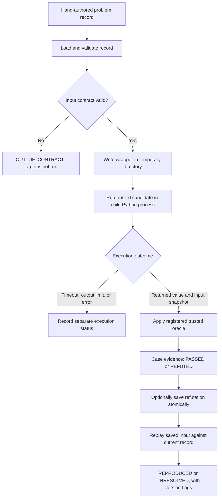

# Abacus threat model

## Execution flow

The problem loader checks record structure; it does not certify that `code` is safe. The harness validates the input before starting a process. For a valid input, it runs the record's candidate through the Day 11 runner and gives the captured return value and mutation snapshot to the registered oracle. A saved counterexample records source data and version hashes; replay runs the case again against the supplied current problem record.

## What the subprocess limits

- It runs the child with the current Python interpreter, isolated Python startup options, a temporary working directory, and no stdin.
- It passes only a small set of platform environment variables, so API keys in the parent process environment are not inherited automatically.
- It captures stdout and stderr with a combined byte limit and stops waiting after the configured timeout. It attempts to terminate the child process tree when a timeout or output limit is reached.
- It removes the temporary program directory after the run.

These are reliability measures. They do not create an operating-system security boundary.

## What the subprocess does not limit

- The child runs with the current user's operating-system permissions. It can read or change any files that user can access, including a project `.env` file. Not inheriting an API key through environment variables does not protect a key stored in a readable file.
- The child can make network connections. There is no network isolation or filesystem access policy.
- There are no memory, disk, or general CPU quotas. A timeout limits how long the parent waits and attempts to stop the ordinary child process tree; it is not a guarantee against every detached descendant or operating-system resource attack.
- The temporary directory is only a working directory. It does not confine filesystem access.
- SHA-256 values in counterexample records identify the target code and problem-record versions. They are not signatures and do not authenticate a counterexample file.

## Code execution rule

Only hand-authored, source-reviewed problem records may be passed to the current harness. Do not execute model-generated or otherwise untrusted code. Keep generated code disabled until a real isolation boundary has been implemented and verified for filesystem access, network access, secrets, process descendants, and resource limits. A subprocess, timeout, isolated Python startup, or environment allow-list alone does not satisfy this rule.

## Evidence and label review

- `OUT_OF_CONTRACT` means the target was skipped. It is not a counterexample.
- `ERROR`, `TIMEOUT`, and `OUTPUT_LIMIT` are execution outcomes, not oracle refutations.
- `REFUTED` requires a contract-valid input, a returned target value, and a mismatch reported by the registered trusted property.
- `PASSED` means only that this finite case passed. It does not prove the claim for every input.
- Replay is `REPRODUCED` only when the saved mismatch appears again with the saved target result and oracle expectation. A non-reproducing case is `UNRESOLVED`; it must not be described as a refutation. Code and problem-record hash mismatches remain visible.

The hand-authored true example delegates to Python's `sorted`, which returns an ascending list for the stated integer domain and does not mutate the input, assuming enough resources for the call to complete. The false example requests `reverse=True`; on `[1, 2]` it returns `[2, 1]`, while the property expects `[1, 2]`. These source-level reasons and the false witness justify the labels without an LLM. The executable sorting oracle also uses Python's `sorted`, so it does not independently validate Python's own sorting implementation; that shared assumption is a limitation of this pilot.
